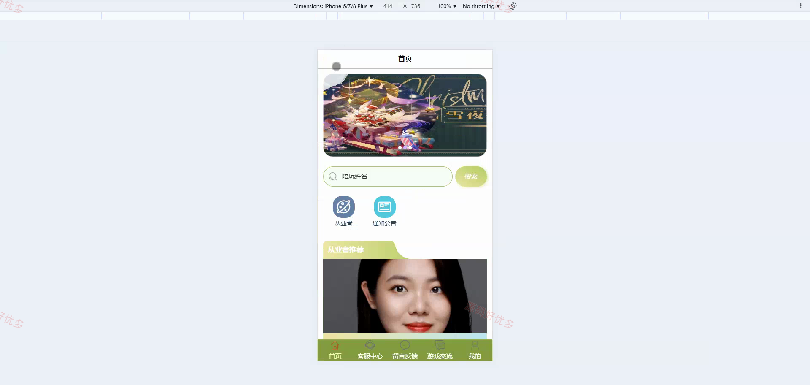
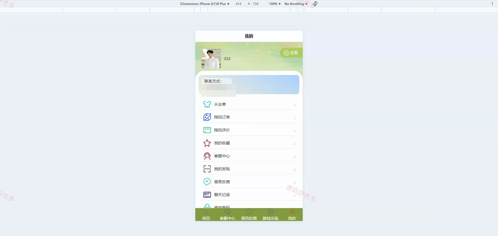
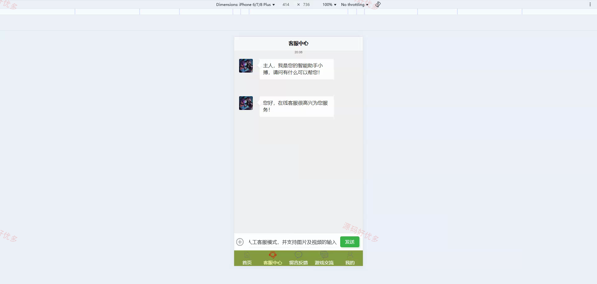
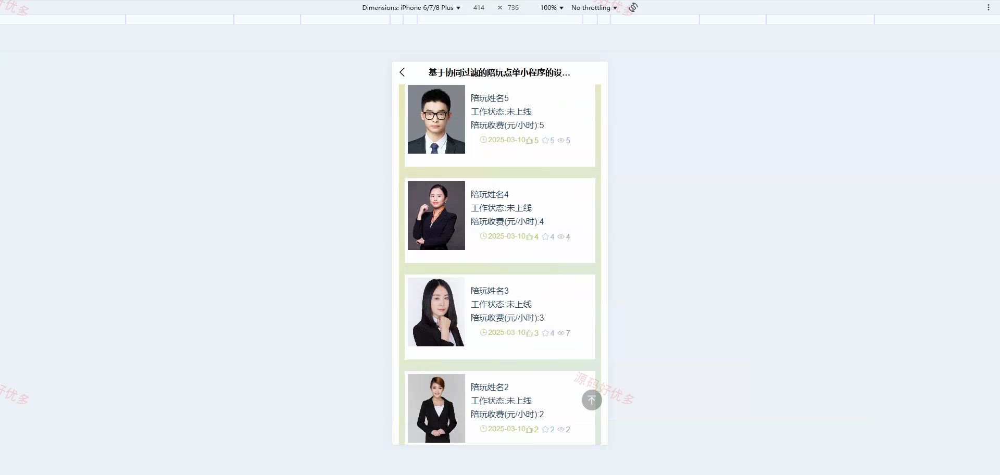
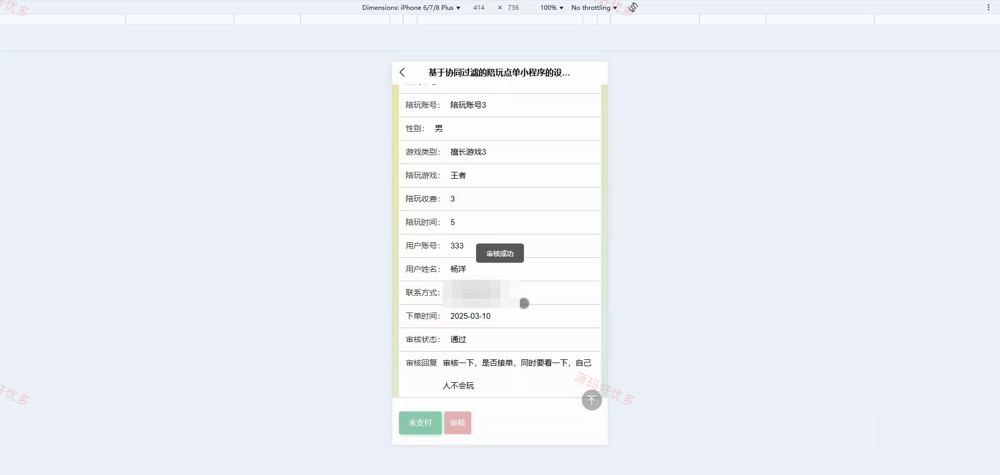
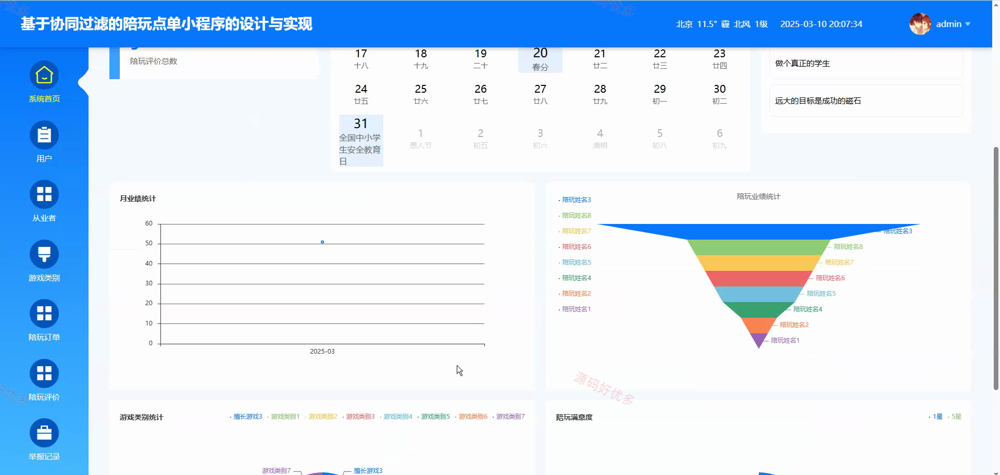
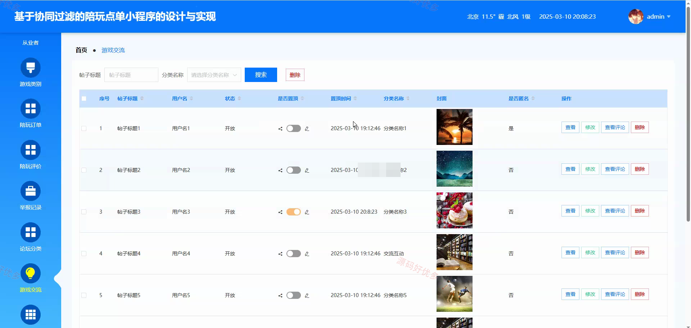
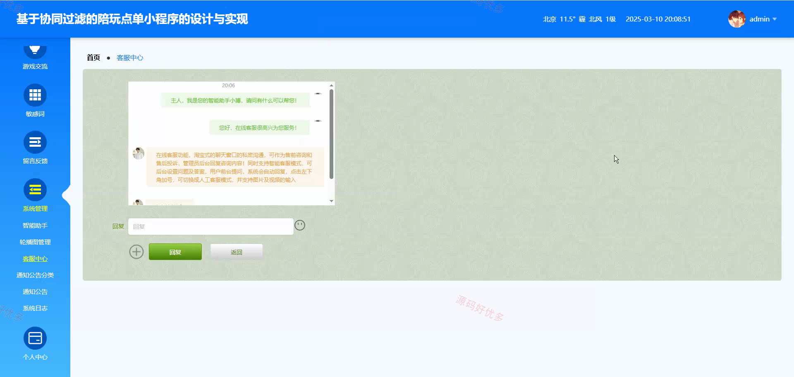

## 源码问题查看主页咨询

### 一、关键词
陪玩点单、游戏陪练、在线约玩、陪玩推荐、陪玩评价

### 二、作品包含
源码+数据库+全套环境和工具资源+本地部署教程

### 三、项目技术
前端技术： Html、Css、Js、Vue2.6、Element-ui、uniapp
后端技术：Java、SpringBoot2.2.2、MyBatis-Plus

### 四、运行环境（以下版本亲测，其他版本兼容性请自行测试）
开发工具：IDEA/eclipse + VSCODE + HBuilder X + 微信开发者工具

数据库：MySQL5.7+（共22张表）

数据库管理工具：Navicat10以上版本

环境配置软件： JDK1.8 + Maven3.6.3

前端Nodejs：14+

浏览器：谷歌浏览器

### 五、项目介绍
项目编号：mpweixinA283D

基于协同过滤的陪玩点单小程序面向用户、从业者与管理员，依据用户收藏记录推荐陪玩从业者，并支持陪玩申请、私聊沟通、订单支付与评价；从业者可审核陪玩订单和查看评价，管理员负责用户、从业者、游戏类别、订单、论坛及公告等内容的维护与统计。

角色：用户、从业者、管理员

用户功能：陪玩推荐与浏览、陪玩浏览与互动、陪玩申请、私聊沟通、订单查看与支付、通知公告查看、个人资料维护。

从业者功能：陪玩订单查看与审核、陪玩评价查看、从业者信息浏览、私聊沟通、通知公告查看、收藏管理、个人资料维护。

管理员功能：用户与从业者管理、游戏类别维护、陪玩订单管理与统计、陪玩评价与满意度统计、游戏交流与举报管理、留言与客服管理、通知公告管理、智能助手与系统日志管理。

### 六、运行截图

